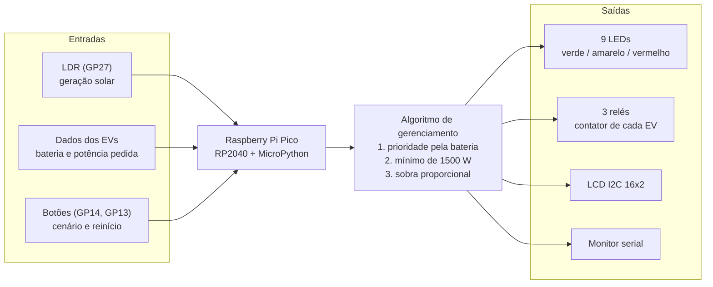

# Challenge_FIAP-GoodWe_Sprint4

**Challenge FIAP + GoodWe – Sprint 4**

Disciplinas: Arquitetura de Computadores (COA) e Soluções em Energias Renováveis e Sustentabilidade (SERS)

## Equipe

| Nome | RM |
|---|---|
|Giovanna Ferreira Almeida | RM571822
|Lucas Bellezzo Figueiredo | RM569734
|Maria Luiza Vieira de Freitas | RM571535
|Matheus Arruda Camara Soares | RM571594
|Matheus Sabino da Silva Guedes | RM572907

## Links

- Vídeo de demonstração (YouTube, não listado): https://youtu.be/q1Fl3sSVPzc
- Projeto no Wokwi: https://wokwi.com/projects/478617179556870145

## Visão geral

A GoodWe Smart Charging Station é uma simulação de estação de recarga de veículos elétricos alimentada por energia solar. Um Raspberry Pi Pico, programado em MicroPython, recebe a energia disponível e os dados de três veículos (bateria e potência pedida) e decide, a cada ciclo, quanta potência cada carro recebe. O projeto é educacional e se inspira no conceito do GoodWe Smart Energy Controller: gerenciar de forma inteligente uma energia limitada. Não reproduz tecnicamente um produto da GoodWe.

O problema: a geração solar varia e a soma dos pedidos dos carros pode ser maior que a energia disponível. Sem controle, ou se desperdiça energia ou se sobrecarrega a instalação.

## Arquitetura



- **Entradas:** o LDR representa a geração solar (leitura do ADC, de 0 a 65535, convertida em 0–8000 W). Os dados dos EVs ficam na memória RAM, numa lista de dicionários (id, bateria, pedido, potência concedida, estado). Dois botões trocam o cenário e reiniciam as baterias.
- **Processamento:** a cada 2 s o Pico lê a energia disponível, executa o algoritmo, atualiza o estado de cada EV e a bateria simulada (cada ciclo representa 5 min de carga).
- **Saídas:** LEDs e relé por carro, LCD I2C e monitor serial.

### As cinco perguntas do funcionamento

- **Quais dados entram?** Geração solar (LDR), bateria e potência pedida de cada EV, e os comandos dos botões.
- **Como o Pico processa?** O MicroPython lê o ADC (0 a 65535), converte em watts e executa o algoritmo a cada 2 s.
- **Onde os dados ficam armazenados?** Na memória RAM, numa lista de dicionários, um por veículo. Não há gravação permanente.
- **Como o sistema decide?** Prioridade pela bateria mais baixa, potência mínima de 1500 W por carro e divisão proporcional da sobra.
- **O que sai?** LEDs e relé por carro, LCD I2C e monitor serial.

## Hardware (Wokwi)

| Componente | Pino(s) | Função |
|---|---|---|
| Raspberry Pi Pico | – | processador central |
| LEDs do EV1 (verde, amarelo, vermelho) | GP0, GP1, GP2 | estado do carro 1 |
| LEDs do EV2 | GP3, GP4, GP5 | estado do carro 2 |
| LEDs do EV3 | GP6, GP7, GP10 | estado do carro 3 |
| Relés do EV1, EV2, EV3 | GP16, GP17, GP18 | contator de cada carro (liga se ele recebe energia) |
| LDR (sensor de luz) | GP27 (ADC) | geração solar |
| LCD 16x2 I2C (endereço 0x27) | GP8 (SDA), GP9 (SCL) | exibe estado, potência e bateria |
| Botão azul | GP14 | troca o cenário de energia |
| Botão preto | GP13 | reinicia a bateria dos EVs |

Os LEDs usam resistores de 220 Ω. Significado das cores: **verde** = recarga ativa, **amarelo** = recarga reduzida, **vermelho** = em espera.

## Algoritmo de gerenciamento de energia

Dados: energia disponível `D` (W) e, para cada EV, a bateria (%) e a potência pedida (EV1: 2000 W, EV2: 2500 W, EV3: 3000 W).

1. **Prioridade:** os EVs com bateria abaixo de 100% entram numa fila ordenada pela bateria, do menor para o maior.
2. **Potência mínima:** seguindo a fila, cada EV recebe `min(1500 W, pedido)` enquanto houver energia. Se a energia acabar, os demais ficam em **espera**.
3. **Divisão da sobra:** a energia restante é dividida proporcionalmente ao que ainda falta para cada EV atendido, sem passar do pedido.

Estado de cada EV: `ATIVA` (recebe o que pediu), `REDUZIDA` (recebe menos que pediu), `ESPERA` (não recebe) ou `CHEIO` (bateria em 100%).
Status da estação: `RECARGA LIMITADA` (algum EV em espera), `RECARGA CONTROLADA` (algum reduzido) ou `RECARGA ATIVA`.

## Cenários e resultados

Demanda total: 7500 W. Bateria inicial: EV1 20%, EV2 45%, EV3 70%.

| Cenário | Energia disponível | EV1 | EV2 | EV3 | Status |
|---|---|---|---|---|---|
| ALTA | 8000 W | 2000 W (verde) | 2500 W (verde) | 3000 W (verde) | RECARGA ATIVA |
| LIMITADA | 5000 W | 1583 W (amarelo) | 1666 W (amarelo) | 1750 W (amarelo) | RECARGA CONTROLADA |
| BAIXA | 2000 W | 2000 W (verde) | espera (vermelho) | espera (vermelho) | RECARGA LIMITADA |
| AUTO | lida do LDR | depende da luz | depende da luz | depende da luz | depende da luz |

Saída do monitor serial no cenário LIMITADA:


Saída no modo AUTO ao final da demonstração (295 W de energia disponível: nenhum carro alcança o mínimo de 1500 W, então todos ficam em espera e os relés desligam):


Na demonstração, a estação entregou **4,51 kWh** de energia solar aos carros e evitou cerca de **0,174 kg de CO₂** (ver a seção de sustentabilidade).

## Representação de dados (COA)

O programa mostra a energia disponível em três sistemas numéricos. Para 5000 W:

| Sistema | Valor |
|---|---|
| Decimal | 5000 |
| Hexadecimal | 0x1388 |
| Binário | 1001110001000 (13 bits, cabe em um inteiro de 16 bits) |

## Relação com Arquitetura de Computadores

| Conceito | Aplicação no projeto |
|---|---|
| Processador | Raspberry Pi Pico (RP2040) |
| Representação de dados | watts, % de bateria e pedidos como números inteiros e de ponto flutuante |
| Sistemas numéricos | decimal, hexadecimal e binário no monitor serial |
| Memória | dados dos EVs na RAM, em uma lista de dicionários |
| Entrada | LDR, botões e dados simulados |
| Processamento | algoritmo de gerenciamento de energia |
| Saída | LEDs, relés, LCD e monitor serial |
| Comunicação | I2C (LCD) e serial (monitor) |
| Automação | decide sozinho quem carrega e com quanta potência |

## Relação com Energias Renováveis e Sustentabilidade

- **Alinhamento com o desafio GoodWe:** a estação reproduz, de forma simplificada, a ideia de um controlador que distribui a energia disponível entre cargas, aproveitando a geração solar em vez de depender só da rede.
- **Eficiência energética:** o controlador usa a energia solar disponível ao máximo (no cenário LIMITADA entregou 4999 W de 5000 W; o 1 W de diferença vem do truncamento do cálculo proporcional em inteiros) sem passar do limite.
- **Automação inteligente:** a prioridade pela bateria mais baixa e a divisão proporcional são decididas sem intervenção humana, a cada 2 s.
- **Pegada de carbono:** o programa estima o CO₂ evitado como `energia entregue (kWh) × 0,0385 kg/kWh`, usando um fator médio de emissão da rede elétrica brasileira. **[PREENCHER: confirmar a fonte e o ano desse fator antes de citar.]**

### Diferenciais

- Algoritmo de distribuição com prioridade pela bateria e divisão proporcional, em vez de liga/desliga simples.
- Um relé (contator) por veículo, que mostra a decisão do controlador também fora dos LEDs.
- Visualização dos dados em LCD I2C e no monitor serial, com a energia em decimal, hexadecimal e binário.
- Estimativa de energia entregue (kWh) e de CO₂ evitado calculada pelo próprio Pico.
- Não implementamos painel web nem integração com assistente virtual.

### Avaliação crítica

- **Benefícios:** uso da energia solar na hora, sem sobrecarregar a instalação; decisão automática; prioridade ao carro mais descarregado; dados visíveis em LEDs, LCD e serial.
- **Limitações:** é uma simulação, e o LDR representa a geração solar; a rede brasileira é relativamente limpa, então o ganho de CO₂ é pequeno; não há bateria estacionária nem medidor real; a bateria e o tempo dos carros são simulados de forma simplificada.

## Como executar

1. Abra o Wokwi (<https://wokwi.com>) e crie um projeto **MicroPython on Raspberry Pi Pico**.
2. Substitua o conteúdo de `main.py` e de `diagram.json` pelos arquivos deste repositório.
3. Clique em **Play**. O monitor serial mostra os dados a cada 2 s e o LCD alterna entre o resumo e cada carro.
4. Use o botão azul (GP14) para alternar os cenários na ordem **AUTO → ALTA → LIMITADA → BAIXA**. No modo AUTO, clique no LDR e mude o valor de lux para variar a geração. O botão preto (GP13) reinicia a bateria dos carros.

## Estrutura do repositório

```
README.md        este documento
main.py          código MicroPython da estação
diagram.json     circuito do Wokwi
docs/ROTEIRO.md  roteiro do vídeo
docs/img/        prints do monitor serial
```

## Referências

- Raspberry Pi Pico e MicroPython: <https://docs.micropython.org/en/latest/rp2/quickref.html>
- Datasheet do RP2040: <https://datasheets.raspberrypi.com/rp2040/rp2040-datasheet.pdf>
- Simulador Wokwi: <https://docs.wokwi.com/>
- GoodWe (conceito de gerenciamento inteligente de energia): <https://www.goodwe.com/>
